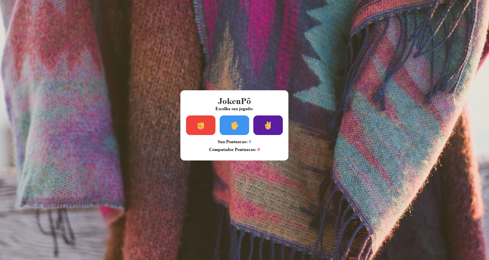

# ✊✋✌️ Joquempô — Jogador vs IA

Um jogo de Joquempô (Pedra, Papel e Tesoura) desenvolvido para permitir que o usuário desafie uma inteligência artificial em partidas rápidas e interativas.

O projeto foi criado como parte dos meus estudos em desenvolvimento web, com o objetivo de praticar lógica de programação, manipulação do DOM e geração de escolhas aleatórias utilizando JavaScript.

## 🚀 Funcionalidades

- ✊ Escolha entre Pedra, Papel ou Tesoura.
- 🤖 Sistema de jogadas aleatórias para a IA.
- ⚔️ Comparação entre a escolha do jogador e a escolha da IA.
- 🏆 Identificação automática do vencedor de cada rodada.
- 🤝 Reconhecimento de empates.
- 🎮 Interface interativa para jogar diretamente no navegador.

## 🛠️ Tecnologias Utilizadas

- **HTML5:** estruturação dos elementos do jogo.
- **CSS3:** estilização e apresentação visual da interface.
- **JavaScript:** lógica do jogo, geração de escolhas aleatórias, manipulação do DOM e identificação dos resultados.

## 📚 Objetivos de Aprendizado

Durante o desenvolvimento deste projeto, pratiquei conceitos importantes, como:

- Estruturas condicionais (`if` e `else`).
- Manipulação do DOM com JavaScript.
- Tratamento de eventos e interações do usuário.
- Comparação de valores e definição de resultados.
- Integração entre HTML, CSS e JavaScript.

## 🔮 Melhorias Futuras

- [ ] Implementar um placar para acompanhar as vitórias, derrotas e empates.
- [ ] Adicionar animações às jogadas.
- [ ] Aprimorar a responsividade para dispositivos móveis.
- [ ] Melhorar os efeitos visuais e a experiência do usuário.

---

Desenvolvido como parte da minha jornada de aprendizado em desenvolvimento web, buscando evoluir continuamente minhas habilidades em HTML5, CSS3 e JavaScript.
